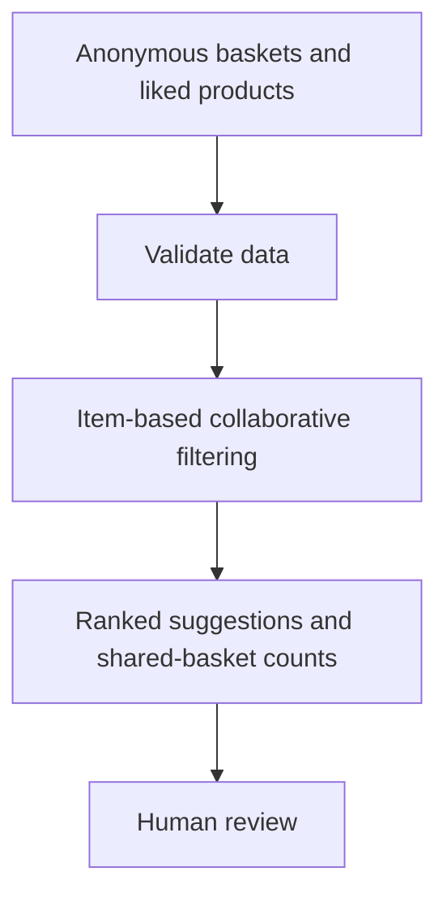

# BasketBridge

Suggest related products from anonymous shopping baskets. Built with AI assistance on 12 November 2026.

## Practical example
People buying a notebook also buy a pen in two of three notebook baskets. The sample ranks pen above pencil.

## Run
Install Python 3.10 or newer. Extract the supplied ZIP and open a terminal in its root folder. Run:

```bash
python projects/basket_bridge_20261112/app.py projects/basket_bridge_20261112/example.json
```

On Windows, use `py` if `python` is unavailable. No pip installation or API key is needed. Copy example.json to a new file, replace the synthetic values with your own data, and pass that file path. Output is JSON printed to the terminal. Invalid files exit with code 2 and an error message. The input file is read-only.

## Workflow


## How it learns
The model learns which products occur together. Jaccard similarity is shared baskets divided by baskets containing either product. It averages similarity over known liked products, excludes already-liked items, and breaks ties alphabetically. Repeated items inside one basket count once. Unknown items are reported and insufficient evidence returns an empty list.

## Features and tools
Python standard library, JSON input/output, transparent model evidence, bounded input sizes, reproducible synthetic example and automated tests. The model fits the supplied data on each invocation and works offline. A 1 MB file limit applies to DemandPath and SensorScout, and 2 MB to BasketBridge.

## Tests
From the ZIP/repository root:

```bash
python -m unittest discover -s tests -v
```

The new test suite includes expected outcomes, invalid inputs, edge cases, input preservation and successful/invalid CLI flows for all three projects. Synthetic checks establish code behavior. Real-world accuracy requires separate representative data.

## Limits
1–1000 baskets, at most 100 product names per basket, limit 1–20. Names are case-sensitive after trimming whitespace. Sparse data and popularity bias affect results. Scores measure association, not purchase probability. Use anonymous product IDs only.

This delivery provides runnable command-line source. A hosted browser preview has not been deployed for this project.
