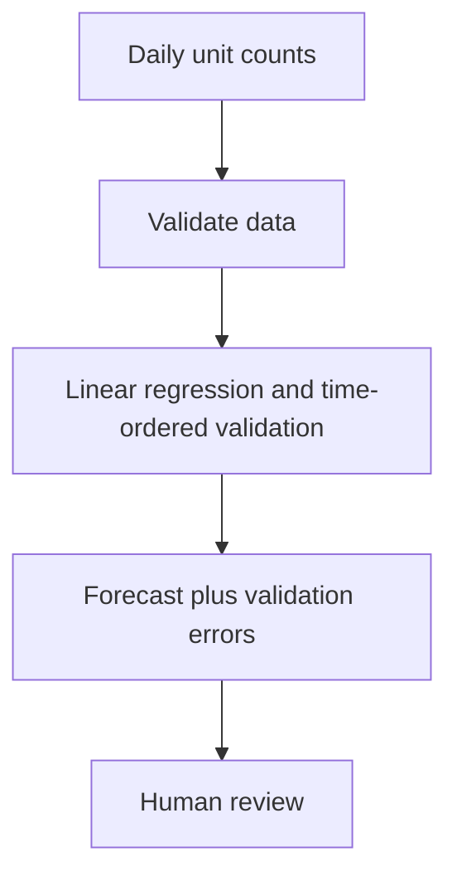

# DemandPath

Estimate a shop's next few days of sales. Built with AI assistance on 12 November 2026.

## Practical example
A shop sold 10, 12, 14 ... 26 units over nine days. The sample predicts 28, 30 and 32 units.

## Run
Install Python 3.10 or newer. Extract the supplied ZIP and open a terminal in its root folder. Run:

```bash
python projects/demand_path_20261112/app.py projects/demand_path_20261112/example.json
```

On Windows, use `py` if `python` is unavailable. No pip installation or API key is needed. Copy example.json to a new file, replace the synthetic values with your own data, and pass that file path. Output is JSON printed to the terminal. Invalid files exit with code 2 and an error message. The input file is read-only.

## Workflow


## How it learns
Daily observations must be consecutive and equally spaced. The app learns a straight-line trend, tests it against the last observed value on a final holdout, then refits the winning method on all input. MAE means average absolute prediction error in units. Ties select the simpler last-value method. Forecasts are clipped at zero.

## Features and tools
Python standard library, JSON input/output, transparent model evidence, bounded input sizes, reproducible synthetic example and automated tests. The model fits the supplied data on each invocation and works offline. A 1 MB file limit applies to DemandPath and SensorScout, and 2 MB to BasketBridge.

## Tests
From the ZIP/repository root:

```bash
python -m unittest discover -s tests -v
```

The new test suite includes expected outcomes, invalid inputs, edge cases, input preservation and successful/invalid CLI flows for all three projects. Synthetic checks establish code behavior. Real-world accuracy requires separate representative data.

## Limits
6–1000 observations, values 0–1 billion, horizon 1–30. Missing days must be filled meaningfully before use. Seasonality, holidays and sudden changes are unmodeled. A small validation sample cannot establish future accuracy.

This delivery provides runnable command-line source. A hosted browser preview has not been deployed for this project.
