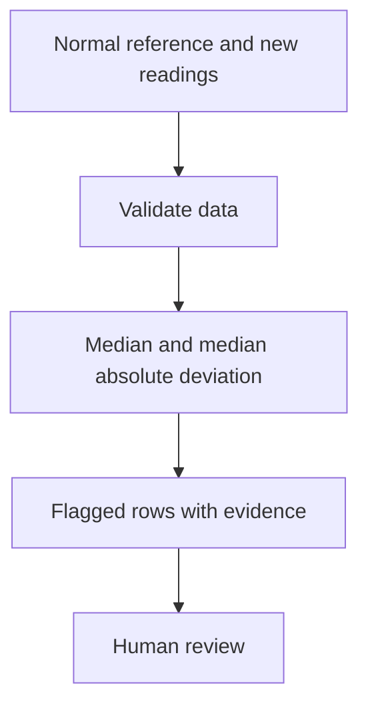

# SensorScout

Flag unusual readings from equipment sensors. Built with AI assistance on 12 November 2026.

## Practical example
Reference temperatures are around 20. The sample flags 45 for inspection and accepts 20 and 21.

## Run
Install Python 3.10 or newer. Extract the supplied ZIP and open a terminal in its root folder. Run:

```bash
python projects/sensor_scout_20261112/app.py projects/sensor_scout_20261112/example.json
```

On Windows, use `py` if `python` is unavailable. No pip installation or API key is needed. Copy example.json to a new file, replace the synthetic values with your own data, and pass that file path. Output is JSON printed to the terminal. Invalid files exit with code 2 and an error message. The input file is read-only.

## Workflow


## How it learns
The app learns the reference median and MAD. A reading is flagged when its modified z-score exceeds the threshold, default 3.5. New readings never affect the reference. When MAD is zero, any departure from the median is flagged with a null score and an explicit rule label.

## Features and tools
Python standard library, JSON input/output, transparent model evidence, bounded input sizes, reproducible synthetic example and automated tests. The model fits the supplied data on each invocation and works offline. A 1 MB file limit applies to DemandPath and SensorScout, and 2 MB to BasketBridge.

## Tests
From the ZIP/repository root:

```bash
python -m unittest discover -s tests -v
```

The new test suite includes expected outcomes, invalid inputs, edge cases, input preservation and successful/invalid CLI flows for all three projects. Synthetic checks establish code behavior. Real-world accuracy requires separate representative data.

## Limits
Reference needs 5–10000 readings and the new batch 1–10000. Use comparable units and stable equipment conditions. The zero-MAD policy is deliberately sensitive to any variation. This statistical detector needs operator review and is unsuitable as the sole safety control.

This delivery provides runnable command-line source. A hosted browser preview has not been deployed for this project.

Extremely large anomaly scores are capped at 1e300 to keep JSON output finite.
