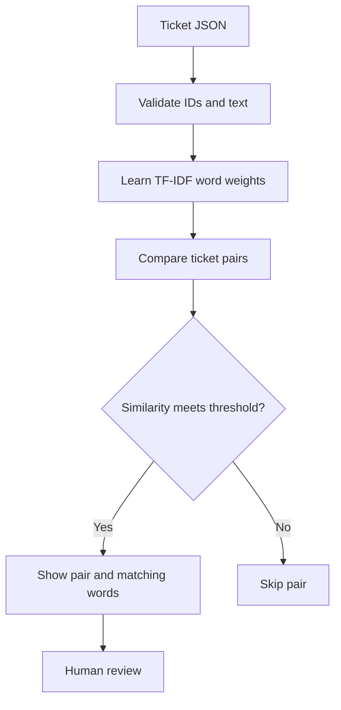

# TicketTwin — duplicate support-ticket review
Built 6 November 2026 for Mahindra. A practical offline classical NLP project, not a generative chatbot.

## Problem and example
A shop gets two complaints: "payment charged twice refund" and "refund payment charged twice". Staff should see that they may describe the same issue before repeating work. TicketTwin suggests related pairs with matching words. A person decides whether they are duplicates.

## Run in three steps
1. Install Python 3.10 or newer and download this repository.
2. Open a terminal in the repository root.
3. Run:
```bash
python -m projects.ticket_twin_20261106.app projects/ticket_twin_20261106/tickets.json
```
On Windows, use `py` instead of `python` if needed. No pip packages, paid APIs, account, or model download is needed. On a tablet, you can read the project on GitHub; running it needs a Python environment.

## How it works

TF-IDF gives more weight to distinctive words. Cosine similarity compares each pair of normalized word vectors. A score near 1 means similar word usage, not a probability of being a true duplicate. The model fits the supplied batch locally. Reuses the repository's existing tested NLP utilities.

## Input and output
Input: UTF-8 JSON array of objects with unique string `id` and nonempty `text`.
Output: JSON with number of tickets checked, candidate ticket IDs, similarity, shared terms, and human-review action. The sample returns T001/T002; T003 is unrelated. Original files are never modified.

Use `--threshold 0.8` for stricter matching; valid values are greater than 0 and at most 1. The default 0.65 is a demonstration setting, not a validated business threshold.

## Test
From the repository root:
```bash
python -m unittest discover -s tests -v
```
Tests cover matching, unrelated tickets, empty/single batches, invalid input, duplicate IDs, non-finite thresholds, case normalization, boundaries, batch limit, CLI success, and missing files.

## Limits
English-focused lexical matching misses synonyms and can confuse opposite statements such as "payment received" and "payment not received". No automatic merging or deleting. No production accuracy is claimed; sample tickets are synthetic. Evaluate with real labeled pairs before operational use. Maximum 500 tickets, 10000 characters each, 6 MB input file; pairwise comparison scales quadratically. This is a command-line application; uploading to GitHub does not make it a live website.

Created with AI assistance. Understand and extend the implementation before presenting it as your own independent work.
